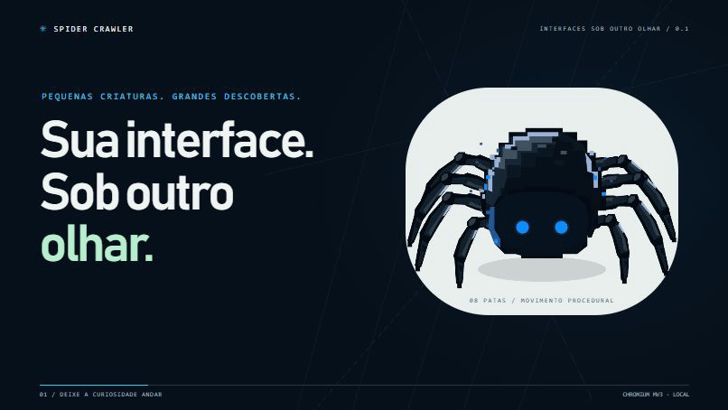
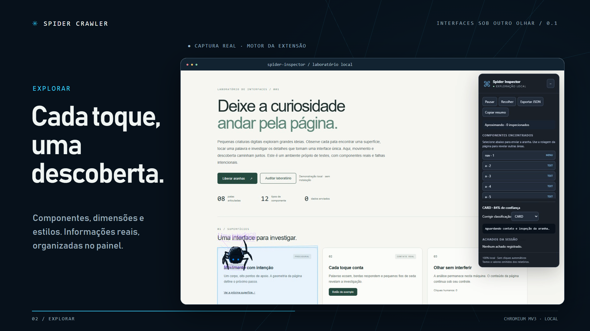
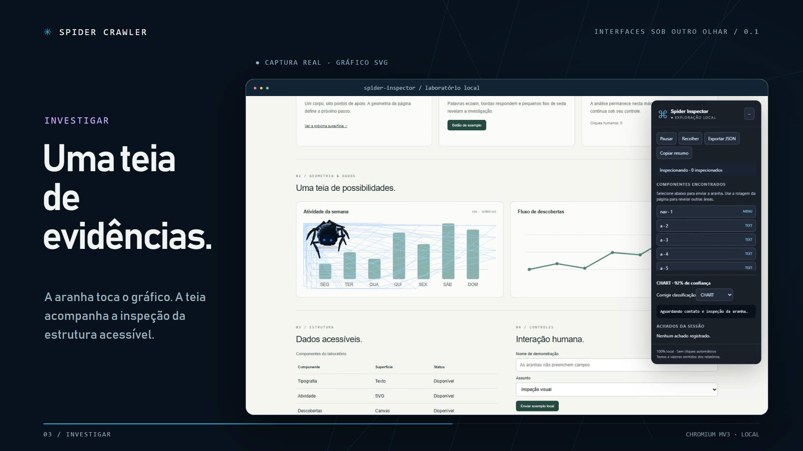
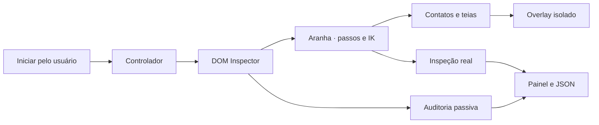

# Spider Crawler

### Sua interface. Sob outro olhar.

Pequenas aranhas digitais caminham pela página, tocam componentes e transformam curiosidade em informações sobre a interface.

**Spider Inspector** é a extensão Chromium deste projeto: exploração visual, inspeção do DOM e auditoria passiva, com processamento local.

<kbd>Manifest V3</kbd> <kbd>TypeScript</kbd> <kbd>Canvas 2D</kbd> <kbd>8 patas · IK</kbd> <kbd>Português brasileiro</kbd>

[](docs/media/spider-crawler.mp4)

**[▶ Assistir à apresentação — 36 segundos, Full HD](docs/media/spider-crawler.mp4)**  
[Player local com capítulos e legendas](docs/apresentacao.html) · [Instalação](#comece-em-poucos-passos) · [Guia completo](docs/GUIA.md) · [Validação](docs/TESTES.md)

> Animação em **JavaScript/JSX com Remotion**, personagem aprovado e capturas reais do laboratório. Trilha original, sem narração. [Código e reprodução do vídeo](video/README.md).

---

## Uma criatura que investiga

A aranha acompanha o trabalho: caminha até um alvo, posiciona as patas, toca a superfície e só então registra a inspeção. O personagem B tem corpo em camadas, contornos pixelados, dois olhos azuis e oito membros articulados.

| Explorar | Auditar |
|---|---|
| Componentes classificados, dimensões, cores, tipografia e espaçamentos. | Verificações passivas de imagens, nomes acessíveis, campos, links e contraste. |
| Evidências do DOM renderizado e informações acessíveis de SVG e Canvas. | Achados com evidência, grau de certeza e sugestões de investigação. |
| Correção manual da classificação, JSON e resumo técnico. | Marcadores visuais e aproximação da aranha ao componente. |

**Uma a três aranhas.** Pausar, continuar e recolher. Contraste adaptativo à superfície, preferências locais e respeito à redução de movimento.

## Veja o produto trabalhando

| Contato e inspeção | Teias sobre gráficos |
|---|---|
|  |  |

As reações aparecem no ponto de contato: ecos de palavras, pressão em botões, contornos de cards e teias em gráficos. A camada visual fica isolada em Shadow DOM; a página continua utilizável.

A auditoria apresenta **erro confirmado**, **possível problema**, **observação** ou **sugestão**, conforme a evidência disponível. Ela não substitui uma avaliação completa de acessibilidade.

## Comece em poucos passos

Requisitos para compilar: **Node.js 22.12+** e npm. Validado com Node 24 no Windows.

```powershell
npm.cmd ci
npm.cmd run build
```

1. Abra `chrome://extensions` no Chrome ou `opera://extensions` no Opera GX.
2. Ative **Modo do desenvolvedor**.
3. Clique em **Carregar sem compactação** e selecione a pasta **dist**.
4. Abra uma página compatível, clique no ícone da extensão e em **Liberar aranhas**.

Escolha **Explorar** ou **Auditar**, selecione um componente no painel e observe a investigação. Exporte os resultados antes de **Recolher**.

**Para atualizar:** execute `npm.cmd run build`, clique em **Recarregar** no cartão da extensão e atualize a aba inspecionada. [Instalação detalhada e uso](docs/GUIA.md).

## Experimente no laboratório

```powershell
npm.cmd run dev
```

Abra o endereço indicado pelo Vite, normalmente `http://127.0.0.1:5173`.

| Caminho local | O que você encontra |
|---|---|
| `/` | Demonstração funcional com texto, cards, gráficos, tabela, formulário e falhas intencionais. |
| `/preview/comparison.html` | Referência A, personagem aprovado B e desenho anterior C, com caminhada procedural. |
| `/docs/apresentacao.html` | Vídeo completo, capítulos, legendas e transcrição. |

Os botões do laboratório executam o mesmo motor para desenvolvimento. Para testar a extensão instalada, inicie pelo ícone do navegador e evite duas sessões simultâneas.

## Privacidade por padrão

- Inspeção local, sem envio do conteúdo para servidores ou modelos de IA.
- Permissões de produção: `activeTab`, `scripting` e `storage`.
- Sem cliques automáticos, preenchimento ou envio de formulários.
- Valores de campos e textos são minimizados nos relatórios; sem coleta de cookies ou tokens.
- Recolher remove o overlay e libera animações, observers e listeners.

[Como a privacidade é tratada](docs/PRIVACIDADE.md)

## Por dentro



O produto usa APIs nativas, TypeScript e Canvas 2D. O projeto Remotion está isolado em `video/`; suas dependências não entram na extensão.

## Validado, com limites claros

A integração do personagem B passou em **11 cenários Playwright** e **2 testes de IK**: extensão MV3, caminhada, contatos, teias, inspeção, exportação, auditoria, três aranhas, movimento reduzido e limpeza.

No cenário local com três aranhas e 3.000 nós adicionais, a amostra registrou **59,3 FPS**. Desempenho varia com o site e o equipamento. [Resultados e limites dos testes](docs/TESTES.md).

```powershell
npm.cmd run test:unit
npm.cmd test
npm.cmd run package
```

**Limitações do MVP:** páginas internas e contextos protegidos não são compatíveis; a amostra cobre o documento principal, até 600 componentes e 12.000 nós. Há verificações parciais de acessibilidade, sem auditoria ativa ou acesso aos dados internos de gráficos. Os relatórios descrevem a interface renderizada, não o código-fonte original.

O Opera GX e o gesto de autorização no perfil pessoal requerem validação manual. [Todas as limitações e roteiro de teste](docs/GUIA.md#limitações-conhecidas).

## Documentação e créditos

[Guia técnico](docs/GUIA.md) · [Decisões](docs/DECISOES.md) · [Aparência B](docs/REDESIGN.md) · [Produção do vídeo em JavaScript](video/README.md)

Referência estética e técnica: [web-crawlers, de cyohei9907](https://github.com/cyohei9907/web-crawlers), inspirado no trabalho visual de Slava Rybin. A implementação é independente; não incorpora código ou assets desse repositório, cuja revisão analisada não apresentava licença explícita.

Próximos passos: ampliar a cobertura de interfaces e os testes em sites autorizados, melhorar as representações de superfícies e preparar testes ativos com autorização específica.

